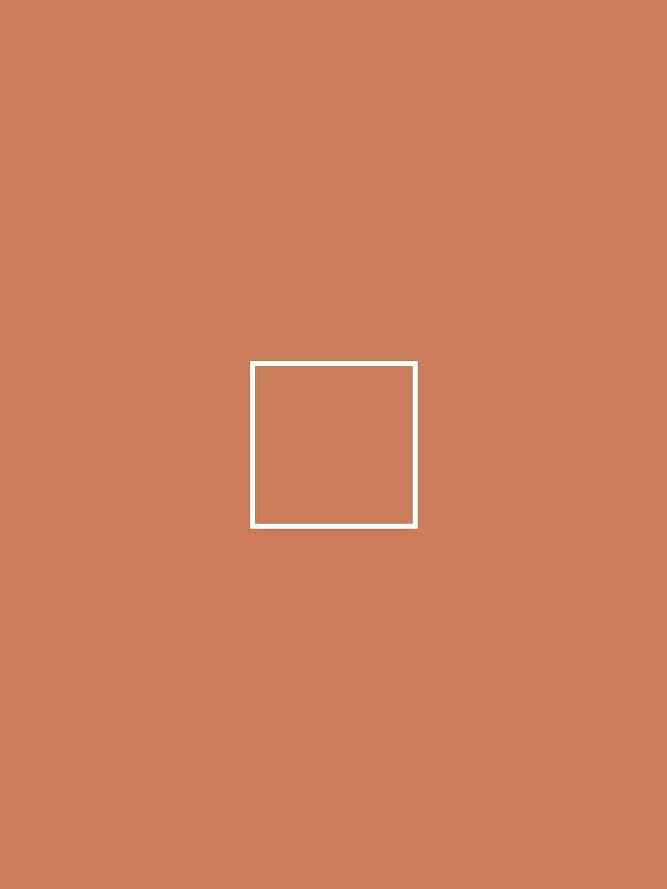

# 微信公众号「左右滑动」图片排版工具

一个针对**微信公众号图文**的开源排版方案：让一组图片在手机端**左右滑动查看**（横向滑动画廊），并附带一键复制工具，**全程不需要 135 编辑器 / 秀米等第三方编辑器**，写好 HTML → 复制 → 粘贴进公众号后台即可发布。

> 适用场景：多图展示（截图合集、作品集、案例对比、步骤演示）、氛围图、人物自述/故事类长文配图、任何想节省纵向空间又想引导互动的图文排版。

---

## 一、这个工具解决什么问题

公众号官方编辑器**不支持**插入横向滑动图片组件。常见的做法是去 135 编辑器 / 秀米里套模板再粘贴回来，但存在几个痛点：

| 痛点 | 本工具的解法 |
|---|---|
| 必须注册使用第三方编辑器，样式受模板限制 | 纯 HTML 内联样式，完全自主可控，改代码即改样式 |
| 从浏览器全选复制到公众号，图片经常抓不到 | 图片托管在 https 公网（GitHub Pages），微信粘贴时服务器**自动抓图转存**到微信图床 |
| 复制后微信检测报「文字对齐异常 / 非标准值」 | 一键复制工具**绕过浏览器的样式改写**（详见下文原理） |
| 网上流传的 flex 滑动组件粘到公众号就失效 | 采用微信兼容的 `white-space: nowrap + inline-block` 结构（详见下文原理） |

---

## 二、核心原理（为什么这么写）

### 2.1 滑动组件为什么不用 flex

网上常见的滑动组件用 `display: flex` 实现。**实测微信公众号编辑器在粘贴时会剥掉 `display: flex`**，导致图片失去横向排列、滑动失效。

微信编辑器完整支持的是行内排版属性，所以本工具采用等价的兼容写法：

```html
<!-- 容器：white-space:nowrap 强制不换行，font-size:0 消除图片间的空白间隙 -->
<section style="overflow-x:auto; overflow-y:hidden; -webkit-overflow-scrolling:touch; white-space:nowrap; font-size:0; padding:2px 0 6px;">
  <!-- 图片：inline-block 定宽横向排开；width:78% 故意露出下一张的一角，暗示可滑动 -->
  
  
</section>
<p style="text-align:center; font-size:12px; color:#B54A33; margin:6px 0 18px;">◂ 左右滑动查看更多 ▸</p>
```

要点：

1. **容器** `white-space:nowrap` —— 让所有图片排成一行不换行，这是滑动能生效的前提
2. **容器** `font-size:0` —— 消除 inline-block 元素之间的天然空隙（否则图片间会有约 4px 缝）
3. **图片** `width:78%`（或多图时 72%）—— 单屏只完整显示一张 + 露出下一张的边，用户一看就知道能滑
4. **图片** `max-width:300px` —— 封顶宽度，避免在窄屏（375px 视口）上触发微信「内容溢出」检测
5. **底部滑动提示** —— 明确的引导文案，提升滑动率

### 2.2 为什么图片必须部署到公网

公众号后台**不支持上传 HTML**，唯一路径是「网页内容粘贴」。粘贴时微信服务器会抓取 HTML 里的图片地址并**转存到微信图床**。微信的服务器抓不到 `file://` 本地路径和 `http://localhost`，所以排版文件（连同图片）必须先部署到**纯 https 公网直链**上。

本项目用 **GitHub Pages** 托管：免费、无鉴权、直链稳定，微信服务器抓取成功率高。

### 2.3 为什么要用 copy.html 一键复制，而不是在页面上 Ctrl+A 全选复制

这是本项目最隐蔽也最关键的坑：

- 在 Chrome 里全选复制网页时，剪贴板里装的**不是网页源码**，而是浏览器重新序列化后的「计算样式」
- Chrome 会把 `text-align: center` 改写成 `text-align: -webkit-center`，部分元素还会带上非标准值 `start`
- 微信官方插件规范（§1.6 text-align）明确规定：**只允许标准值，禁用 start/end**，扫到就报「文字对齐异常 · 非标准值」

所以即使你的源码完全合规，经过浏览器全选复制这一步，到微信手里就已经被污染了。

`copy.html` 的解法：页面用 JavaScript 的 **Clipboard API（`navigator.clipboard.write`）把原始 HTML 字符串直接写入剪贴板**（`text/html` 格式），中间不经过浏览器的样式计算，微信收到的就是一份干净的、完全合规的源码。

### 2.4 为什么本工具不提供「自动轮播」

不少人会问：公众号禁 JS，那能不能用 SVG 动画（`<animateTransform>` + `<image>`）做自动轮播？

**实测结论：通过「复制粘贴」的方式不行。** 把带 SVG 轮播的内容粘进公众号后台，再看预览页的源码，会发现：

- 微信**保留了** `<svg>`、`<g>`、`<animateTransform>` 这些标签
- 但会**删除所有 `<image>` 元素**（SVG 里用来承载图片的标签），于是动画组是空的，图片一张都不显示

原因：公众号编辑器对 SVG 只放行部分标签，`<image>` 不在白名单里。所以纯粘贴路径下 SVG 图片轮播无法生效；135 / 壹伴这类带 SVG 轮播的工具，是靠「微信同步（API）」把内容写进后台的，而不是靠粘贴。

> 结论：本项目专注「粘贴即可用」，因此只提供 100% 兼容的**手动左右滑动**，不做自动轮播。若你确实需要自动播放，可行替代是：把多张图合成一张**循环 GIF**，再用普通 `` 引入——GIF 由微信自动播放，且兼容性最好。

---

## 三、操作步骤（三步发布）

### 第 1 步：改内容

把 `index.html` 里的内容换成你自己的：

1. **替换图片**：`index.html` 里的图片直接引用**公网 https 地址**（`https://img.hadrychen.top/...`），把它们换成你自己的公网直链即可（改的是每个 `` 的 `src`）
2. **改文字**：搜索示例文字替换成你的标题、正文、提示语
3. **增删图片**：一组滑动图 = 一个 `<section>` 容器 + 里面的若干 `` + 底部一行提示 `<p>`；在 `<section>` 里增删 `` 就行，最后一张的 `margin-right` 建议设为 `0`

> 为什么先本地改：排版文件是你的「内容源」，以后每次改文章都从这里出发，改完重新推送即可，无需重复劳动。

建议图片统一比例（如 3:4 或 4:3）、单张控制在 300KB 以内（过大图先压缩），滑动体验和加载速度最好。想再加一组滑动图，把那个 `<section>` + 底部提示 `<p>` 整段复制一份即可。

### 第 2 步：部署到公网

推送到你的 GitHub 仓库并开启 Pages（或其他任何能提供 **https 直链** 的静态托管）：

```bash
git init -b main && git add -A && git commit -m "init"
# 在 GitHub 创建空仓库后：
git remote add origin https://github.com/<你的用户名>/<仓库名>.git
git push -u origin main
# 然后在仓库 Settings → Pages → 选 main 分支 → Save
```

部署完成后你会得到 `https://<你的用户名>.github.io/<仓库名>/` 这样的地址。

> 为什么必须这一步：微信粘贴时靠**微信的服务器**去抓你的图片，只有公网 https 直链它能稳定抓到。本地文件、localhost、带登录鉴权的链接都不行。

### 第 3 步：一键复制 → 粘贴到公众号

1. 用 **Chrome 或 Edge** 打开 `https://<你的用户名>.github.io/<仓库名>/copy.html`
2. 点 **「📋 一键复制排版内容」** 按钮，看到「✅ 已复制」
3. 打开公众号后台 → 新建图文 → **Ctrl/Cmd + V 粘贴** → 预览确认 → 群发

粘贴后微信会自动把所有图片转存到微信图床，滑动组件原样保留。

> 为什么用 copy.html 而不是全选复制：见上文 2.3——浏览器全选复制会改写样式，触发微信「文字对齐异常」告警；一键复制写入的是原始源码，没有这个问题。
> 若检测仍提示个别 darkmode / 渐变类告警（米色等浅色卡片背景偶发误报），不影响发布，点「继续插入」即可；发布前用手机预览最终确认。

---

## 四、微信检测避坑清单（实测总结）

| 规则 | 错误写法 | 正确写法 |
|---|---|---|
| 滑动组件 | `display:flex`（粘贴后被剥掉，滑动失效） | `white-space:nowrap` + `display:inline-block` |
| SVG 动画 | 用 SVG `<image>` + `<animateTransform>` 做自动轮播（粘贴后 `<image>` 被删，图片不显示） | 只做手动滑动；自动播放改用循环 GIF（详见 2.4） |
| text-align 值 | `start` / `end` / 被 Chrome 改写的 `-webkit-center` | 只用 `left` / `center` / `right`，且用一键复制避免浏览器改写 |
| text-align 位置 | 写在 `<section>` 容器上（微信检测易报异常） | 下沉到内部 `<p>` / `<h1>` 标签上 |
| 图片宽度 | 无封顶（移动端视口溢出告警） | 加 `max-width` 封顶 |
| 渐变/阴影 | `linear-gradient`、`box-shadow` 的 rgba 渐隐（深色模式检测可能误报为渐变） | 纯色背景 + 1px 边框替代阴影 |
| 图片托管 | 本地路径 / localhost / 带鉴权的临时链接 | 纯 https 公网直链（GitHub Pages） |

---

## 五、目录结构

```
wechat-swipe-layout/
├── index.html      # 排版模板（图片左右滑动组 + 示例文字，改这个）
├── copy.html       # 一键复制工具页（一般不用改）
├── images/         # 本地示例图（可忽略，模板已改用公网 URL）
│   ├── demo-1.jpg
│   ├── demo-2.jpg
│   ├── demo-3.jpg
│   └── demo-4.jpg
└── README.md
```

## 六、常见问题

**Q：粘贴后滑动在电脑编辑器里没反应？**
正常。横向滑动是**手机端触摸交互**，公众号后台的电脑预览里要按住鼠标拖动，或点「手机预览」用微信扫码在手机上看效果。

**Q：粘贴后图片显示破图？**
说明微信没抓到图。检查图片链接是否为纯 https 直链（浏览器无痕模式能直接打开图片才算），以及部署后 Pages 是否已生效（首次构建约 1 分钟）。

**Q：能放多少组滑动图？**
没有硬限制，实测 9 组（30+ 张图）可正常通过检测并发布。图片多时注意压缩体积，否则首屏加载慢。

**Q：一定要 GitHub Pages 吗？**
不是，任何「纯 https、无鉴权、可公开访问」的静态托管都行（如腾讯云 EdgeOne Pages 等）。关键只有一条：微信服务器要能直接抓到你的图片。

**Q：为什么没有自动轮播？**
因为公众号粘贴会删掉 SVG 的 `<image>` 元素，纯 SVG 自动轮播做不了（实测，详见 2.4）。本项目只提供**粘贴即可用**的手动滑动。若要自动播放，把多张图合成循环 GIF 再用 `` 引入即可。

---

## License

MIT —— 随意使用、修改、分发，如果帮到了你，欢迎点个 Star ⭐
